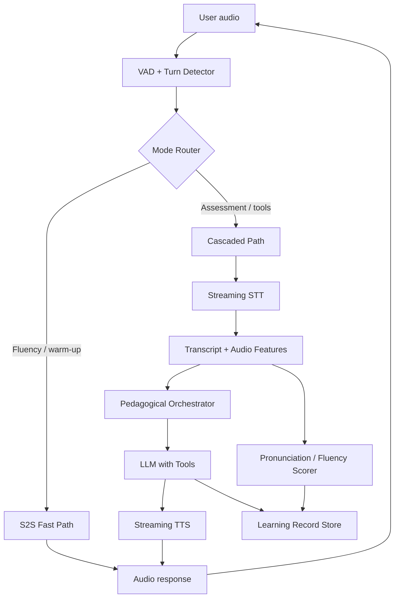

# PREPPED — Specialty Research Artifact

## AI/Voice Pipeline: Real-Time Interaction, Speech Models, Orchestration, and Evaluation

**Scope of this artifact.** This report covers the assigned specialty in depth: real-time voice interaction, speech-to-text (STT), text-to-speech (TTS), speech-to-speech (S2S), streaming, interruption handling, model orchestration, open-source and local inference, tool calling, evaluation, and fallback strategies. It is designed to be combined with four independent reports covering product, learning science, platform architecture, and go-to-market. Where this specialty creates hard dependencies on those other areas, those dependencies are called out explicitly.

**Evidence labeling convention.** Verified facts are cited to primary or authoritative sources. Vendor claims are labeled as such. Academic findings are identified by paper or benchmark. Technical inferences are my own reasoning from the evidence. Untested hypotheses and unknowns are flagged separately.

## 1. Executive Summary for the Voice/AI Specialty

The single most important finding is that **the cascaded streaming pipeline (VAD → STT → LLM → TTS) remains the only architecture that can simultaneously satisfy Prepped’s requirements for pedagogical control, tool use, provider flexibility, and a viable zero-mandatory-spend development path.** End-to-end speech-to-speech (S2S) models are real and improving rapidly, but they are not yet a substitute for a controllable, evaluable, tool-capable tutoring pipeline. The recommended posture is a **cascaded-first architecture with an S2S fast path for low-stakes conversational practice, and a clean abstraction layer that makes S2S a swap-in option rather than a rewrite.**

The second major finding is that **sub-500 ms P95 latency is achievable with managed providers today, but only with aggressive streaming overlap and disciplined per-stage budgets.** The practical budget is: network 30–50 ms, STT first-partial 100–150 ms, LLM time-to-first-token (TTFT) 200–300 ms with prefix caching, TTS first-audio 80–150 ms, and orchestration plus inline guardrails 50–100 ms. The reason the sum exceeds the budget and the P95 still lands near 500 ms is streaming overlap: the LLM begins generating while STT is still producing partials, and TTS begins synthesizing while the LLM is still generating.

The third finding is that **the zero-mandatory-spend constraint is achievable for development and early pilots, but not for production concurrency.** A credible free-tier development stack exists—Deepgram provides a $200 credit, Groq offers a free LLM tier, Cartesia offers 20,000 monthly credits (roughly 27 minutes of TTS or 1 hour 51 minutes of STT), and LiveKit Cloud includes free monthly usage credits. However, these quotas exhaust quickly under realistic testing, and none of the free tiers provide the concurrency, SLA, or data-handling guarantees required for a launched product. The report therefore separates a **development/zero-spend configuration** from an **unrestricted production configuration** in every relevant section.

**Strongest specialty-level opportunity.** Most competing products treat voice as a thin conversational shell around a text model. Prepped can differentiate by treating **the voice signal itself as pedagogical data**: pronunciation, prosody, fluency, hesitation, and turn-taking are not byproducts to be discarded after transcription but first-class signals for assessment and adaptive practice. This requires an architecture that preserves audio alongside transcripts, runs lightweight acoustic scoring in parallel with the conversational pipeline, and feeds those signals into the learning-progress model. No mainstream language-learning product exposes this combination with full provider flexibility and self-hostable components.

## 2. Architecture Alternatives: Cascaded, S2S, and Hybrid

### 2.1 The Three Pipeline Families

There are three viable families for real-time voice interaction. They differ in latency, controllability, observability, and cost structure.

| Dimension | Cascaded (VAD → STT → LLM → TTS) | End-to-end S2S | Hybrid (cascaded + S2S fast path) |
|---|---|---|---|
| Latency (typical) | 500–1,500 ms sum-of-stages; 400–700 ms with streaming overlap | 100–300 ms theoretical; 200–700 ms in practice | 200–400 ms on fast path; 500–800 ms on controlled path |
| Observability | Full: transcript, LLM tokens, TTS text all inspectable | Poor: internal representations opaque | Good on controlled path; limited on fast path |
| Pedagogical control | High: can intervene between stages, apply rubrics, run tools | Low: model behavior is emergent | High on controlled path; constrained on fast path |
| Tool calling | Mature: function calling at LLM stage | Emerging: native tool calling in some models, but constrained | Mature on controlled path; S2S tools limited |
| Provider flexibility | High: mix and match STT, LLM, TTS | Locked to the S2S model provider | Mixed |
| Cost structure | Sum of three providers plus orchestration | Single per-token or per-minute price | Higher platform complexity; potentially lower marginal cost on fast path |
| Self-host feasibility | High: all components have open-weight options | Moderate: Moshi, Qwen2.5-Omni, GLM-4-Voice exist but are heavier | High if fast path is managed, controlled path is self-hosted |

**Verified fact.** The cascaded streaming pipeline “remains the practical architecture for self-hosted realtime voice agents”. A complete cascaded agent using Deepgram streaming STT, a vLLM-served LLM, and ElevenLabs streaming TTS achieved a measured time-to-first-audio of 755 ms (best case 729 ms) with full function-calling support.

**Vendor claim.** Open-source S2S models such as Moshi report a theoretical latency of 160 ms and 200 ms in practice. These figures are credible for the model’s own inference but do not include network transport, turn detection, or application-level orchestration.

**Technical inference.** The latency advantage of S2S is real but narrower than vendor headlines suggest. In a tutoring context, the cost of losing observability and stage-level control is high: you cannot easily inspect whether the learner’s pronunciation was scored correctly, inject a grammar correction between transcription and response, or route a tool call deterministically. S2S is best suited to **low-stakes fluency practice and role-play warm-ups**, where the pedagogical objective is sustained spontaneous speech and the system does not need to interrupt with corrections. The cascaded path should remain the default for **assessment-bearing turns, pronunciation feedback, grammar-focused drills, and any interaction that must call a tool** (e.g., fetching a review item, recording a score, scheduling the next repetition).

### 2.2 Recommended Hybrid Topology

**Component responsibilities.**

- **VAD and turn detector** decides when speech starts, when it ends, and whether a pause is a mid-thought hesitation or a turn yield. It gates both paths.
- **Mode router** is a policy layer, not a model. It selects the fast path or the controlled path based on scenario type, learner state, and explicit pedagogical goals. This is the key architectural decision that prevents S2S from becoming an uncontrolled default.
- **S2S fast path** handles unscripted conversational practice with a single model that ingests audio and emits audio. Tool use and scoring are limited or asynchronous.
- **Cascaded path** exposes the full pipeline for assessment, correction, rubric application, and deterministic tool execution.
- **Pedagogical orchestrator** is where Prepped’s learning logic lives: it reads scenario state, retrieves relevant review items, decides whether to correct, and constructs the LLM prompt with the appropriate persona and constraints.
- **Parallel acoustic scorer** consumes raw audio and transcript to produce pronunciation, fluency, and prosody features. This must not block the conversational loop; it runs asynchronously and writes to the learning record store.
- **Learning record store** is the persistence boundary between the voice pipeline and the learning-progress model. The voice pipeline must not own learner state.

**Dependency on the platform specialty.** The mode router, orchestrator, and learning record store require a session and state-management design that is outside the voice specialty. This report assumes those interfaces exist; it does not specify the database schema or the learning-progress model.

### 2.3 Streaming Is Not Optional

A common implementation mistake is to wait for STT finalization before invoking the LLM, and to wait for the full LLM response before invoking TTS. This produces the 500–1,500 ms sum-of-stages latency and feels sluggish even when each stage is individually fast. The sub-500 ms budget is only achievable when **the LLM consumes STT partials and TTS consumes LLM token deltas**. This creates three engineering requirements:

1. **Partial-result STT** must emit stable partial transcripts with low churn. Deepgram Nova-3 and AssemblyAI Universal-1 are the realistic managed choices in the 100–150 ms first-partial band.
2. **Incremental LLM prompting** must be robust to partial transcripts that change. A conservative policy is to begin generation only when the partial has been stable for a short window or when a semantic turn detector signals completion.
3. **TTS streaming** must accept text deltas and emit audio chunks without sentence-level buffering. Cartesia Sonic and ElevenLabs Turbo/Flash models are designed for this; open-source alternatives require careful chunking.

**Technical inference.** The complexity of correct streaming overlap is a strong argument for using an orchestration framework (Section 4) rather than building the pipeline from scratch. The framework encodes the backpressure, cancellation, and partial-result semantics that are easy to get subtly wrong.

## 3. Model Shortlist: STT, TTS, and S2S

### 3.1 Speech-to-Text

The STT choice is a trade-off between accuracy, latency, language coverage, streaming support, licensing, and cost. The following shortlist covers the viable managed and open-weight options.

| Model | Type | WER (reported) | Latency / streaming | License | Notable constraints |
|---|---|---|---|---|---|
| **Deepgram Nova-3** | Managed | Competitive; not directly comparable across benchmarks | Streaming; first-partial in the 100–150 ms band | Proprietary API | Pay-as-you-go $0.0043/min monolingual, $0.0052/min multilingual; 45+ languages |
| **Deepgram Flux** | Managed | Newer model; promotional pricing | Streaming | Proprietary API | $0.0078/min pay-as-you-go; positioned for conversational workloads |
| **ElevenLabs Scribe v2 Realtime** | Managed | Vendor claims sub-150 ms latency; 90+ languages | Streaming | Proprietary API | Vendor claims $0.40/hour, “72% cheaper than Google or AWS”; treat as vendor claim until independently verified |
| **AssemblyAI Universal-1** | Managed | Competitive | Streaming | Proprietary API | Named in latency budget guidance as a first-partial option |
| **Whisper Large v3 / v3 Turbo** | Open-weight | ~10–12% on Open ASR Leaderboard; generalizes robustly to nonstandard speech | Not natively streaming; requires chunking or faster-whisper | MIT | 809M params; RTFx ~216 for Turbo; not ideal for lowest-latency turn-taking without engineering |
| **NVIDIA Parakeet TDT 0.6B** | Open-weight | ~6.05% WER; RTFx ~3386 | Streaming variants exist; very high throughput | CC-BY-4.0 | 600M params; strong accuracy/efficiency balance; English-focused |
| **NVIDIA Canary Qwen 2.5B** | Open-weight | ~5.63% WER; RTFx ~418 | Batch-oriented; higher latency than Parakeet | Apache 2.0 | 2.5B params; strong accuracy but heavier |
| **Kyutai STT (2.6B)** | Open-weight | ~6.4% WER; RTFx ~88 | Streaming-oriented | CC-BY-4.0 | Designed for streaming; lower throughput |

**Academic finding.** The best ASR models on the Hugging Face Open ASR Leaderboard achieve 5–7% WER on standard benchmarks, but reliability on nonstandard speech remains uncertain; Whisper-Large-v3 generalizes most robustly, while Parakeet shows complementary strengths on dysarthric speech. This matters for Prepped because language learners produce nonstandard speech by definition—hesitations, mispronunciations, L1-influenced phonology—and benchmark WER on clean read speech is a poor predictor of tutoring performance.

**Technical inference.** No single STT model is best for all Prepped scenarios. The pragmatic recommendation is:

- **Managed default for development and launch:** Deepgram Nova-3. It offers streaming, multilingual coverage, and predictable per-minute pricing, with a $200 free credit that makes zero-spend prototyping realistic.
- **Self-hosted default for cost-sensitive or privacy-sensitive deployments:** faster-whisper Large-v3-turbo with INT8 quantization. It runs on CPU with acceptable latency for 5-second utterances (~0.18 s on 8 CPU threads) and can be paired with a GPU LLM and TTS on a single 24 GB card.
- **Accuracy-critical assessment path:** Parakeet TDT 0.6B on GPU, with the transcript reconciled against the faster-whisper output for high-stakes scoring. This is an inference, not a validated design; it requires an experiment.

**Unknown requiring experiment.** How much does STT WER degrade on learner speech with L1 interference, and does that degradation disproportionately affect the acoustic features used for pronunciation scoring? This cannot be answered from existing benchmarks and must be measured on a labeled learner corpus.

### 3.2 Text-to-Speech

TTS quality and latency have improved dramatically, and the managed market is segmented between ultra-low-latency providers (Cartesia) and quality/voice-cloning providers (ElevenLabs).

| Model | Type | Latency (vendor/reported) | Voice cloning | Languages | License / pricing |
|---|---|---|---|---|---|
| **Cartesia Sonic 3** | Managed | ~90 ms; Sonic Turbo ~40 ms | Yes (10 s reference) | 17–42 depending on model | Proprietary; from $10/M input tokens or $0.065/1K chars; free tier 20K credits/mo |
| **ElevenLabs Flash v2.5 / Turbo** | Managed | ~75 ms Flash; ~150 ms standard | Yes, extensive | 70+ | Proprietary; ~$0.05/min for v3 Conversational, ~$0.10/min for standard; free plan 15 minutes |
| **ElevenLabs v3 Conversational** | Managed | ~280 ms | Yes | 70+ | Proprietary; ~$0.05/min |
| **Kokoro** | Open-weight | Realtime on CPU (ONNX int8) | Limited | 8+ languages | Apache 2.0; 82M params |
| **Orpheus** | Open-weight | ~0.2× realtime on CPU; GPU required for realtime | Yes | English-focused | Apache 2.0; 3B params; emotion tags |
| **XTTS v2 (Coqui)** | Open-weight | Moderate | Yes, 17 languages | 17 | Coqui Public Model License; non-commercial by default, commercial use requires separate terms |
| **Piper** | Open-weight | Fastest embedded; ONNX | Limited | Many | MIT |
| **Chatterbox / CosyVoice 2 / OpenVoice v2** | Open-weight | Varies | Yes | Varies | MIT / Apache 2.0 |

**Vendor claim vs. verified fact.** Cartesia’s sub-20 ms claims and ElevenLabs’ 75 ms Flash claims are vendor benchmarks measured under controlled conditions. Cartesia cites 190 ms under typical network conditions. These figures should be treated as lower bounds, not guarantees.

**Academic / benchmark context.** TTS quality is often evaluated on TTS Arena or mean opinion score (MOS). Kokoro reports top TTS Arena ranking and realtime CPU inference, making it the strongest open-weight choice for zero-spend deployments where GPU resources are unavailable. Orpheus offers stronger emotional expressiveness but requires a GPU for real-time operation.

**Technical inference.** For Prepped, the TTS choice is driven by three pedagogical requirements: (1) intelligible, natural speech at conversational speed; (2) the ability to control speed and emphasis for language-learning feedback; and (3) voice consistency across a scenario. Cartesia Sonic 3 is the best managed default for latency and cost, but its voice-cloning quality is secondary to ElevenLabs. Kokoro is the best zero-spend self-hosted default; it is not a replacement for a high-fidelity character voice, but it is sufficient for drills and early scenario prototypes.

### 3.3 Speech-to-Speech

S2S models accept audio and emit audio without an intermediate text bottleneck. The open-weight landscape is evolving quickly.

| Model | Params | Latency | Tool calling | License | Notable constraints |
|---|---|---|---|---|---|
| **Kyutai Moshi** | ~7B (Mimi codec + Helium backbone) | Theoretical 160 ms; ~200 ms in practice | No native tool calling; model card says “cannot access tools” | CC-BY-4.0 | Full-duplex; single voice to avoid impersonation; limited complex-task ability |
| **Qwen2.5-Omni-7B** | 7B | Streaming; not specifically optimized for lowest latency | Emerging | Apache 2.0 | Any-to-any multimodal; strong speech understanding; heavier than Moshi for pure S2S |
| **GLM-4-Voice (9B)** | 9B | Streaming decoder based on CosyVoice | Emerging | Apache 2.0 (code); model terms may differ | End-to-end Chinese/English; emotion and dialect control |
| **NemotronLabs VoiceChat** | Not specified in snippet | Full-duplex | Native tool calling | Open (details require verification) | Explicitly designed for tool calling; a promising direction but maturity is unknown |

**Technical inference.** Moshi is the most mature open S2S model for low-latency conversation, but its inability to access tools and its single-voice constraint make it unsuitable as the primary path for a tutoring product that must fetch review items, record scores, and personalize scenarios. Qwen2.5-Omni and GLM-4-Voice are more capable general models but are heavier and have less mature streaming/tooling ecosystems. The realistic S2S strategy is to use Moshi or a managed S2S API (OpenAI Realtime, Gemini Live, Nova Sonic) for the **fluency fast path**, and to keep the cascaded path for everything that requires tools or fine-grained assessment.

### 3.4 Managed S2S Pricing Comparison

| Provider / model | Pricing | Notes |
|---|---|---|
| **OpenAI gpt-realtime** | $32/M audio input, $64/M audio output, $0.40/M cached input | ~$0.06/min input + ~$0.24/min output; roughly $0.15/min blended |
| **OpenAI gpt-realtime-mini** | $10/M audio input, $0.30/M cached | Lower-cost variant |
| **Gemini Live (gemini-3.x-live)** | $3.00/M audio input ($0.005/min), $12.00/M audio output ($0.018/min) | ~$0.023/min audio output; text output $4.50/M |
| **Amazon Nova 2 Sonic** | $0.33/M input, $2.75/M output | Positioned as significantly cheaper than GPT-4o; vendor claims ~80% cheaper than GPT-4o for the original Nova Sonic |
| **Deepgram Voice Agent API** | $4.50/hour flat | Vertically integrated Nova-3 + Aura-2; ~$0.075/min |
| **ElevenLabs Conversational AI** | ~$0.10/min standard, $0.08/min Business, $0.02–0.03/min at high volume + LLM cost | Latency 1–3 s in vendor comparison; not an S2S model, an orchestration platform |

**Vendor claim.** Amazon claims Nova Sonic is “the most cost-efficient” AI voice model, roughly 80% less expensive than GPT-4o. This is a vendor claim and should be validated against the actual token accounting for Prepped’s conversation lengths.

**Technical inference.** S2S is not automatically cheaper than a cascaded pipeline. At $0.15/min blended for gpt-realtime, a 20-minute practice session costs ~$3.00 in model inference alone. A cascaded pipeline using Deepgram Nova-3 ($0.0043/min), a small LLM ($0.001–0.005/min equivalent), and Cartesia Sonic (~$0.01–0.03/min equivalent) can be substantially cheaper per minute, at the cost of engineering complexity and added latency. For a free-tier product, the cascaded path with free-tier components is the only viable zero-mandatory-spend option; S2S managed APIs will exhaust credits quickly.

## 4. Orchestration Frameworks and Real-Time Transport

### 4.1 Framework Comparison

Two open-source frameworks dominate production voice-agent orchestration: **LiveKit Agents** and **Pipecat**. Both implement the same core pipeline (audio in → STT → LLM → TTS → audio out) with turn detection and interruption handling, and both support a single S2S model in place of the middle three stages.

| Dimension | LiveKit Agents | Pipecat |
|---|---|---|
| License | Apache 2.0 (LiveKit server); SDK licenses vary | BSD-2-Clause |
| Abstraction level | Higher: assumes LiveKit WebRTC/SIP transport; wires the pipeline for you | Lower: transport-agnostic; lets you compose, reorder, and branch stages |
| Transport | LiveKit’s open-source WebRTC SFU and SIP server | Bring your own transport; supports multiple |
| Strengths | Production-ready scaling, dispatch, multi-party, telephony; “already correct at every stage you didn’t touch” | Maximum flexibility; vendor-swappable components; full control over pipeline shape |
| Weaknesses | Gives up transport choice and ability to add/reorder stages | More integration work; you own more of the correctness |
| Best fit for Prepped | If telephony or multi-party scenarios are required; if the team wants a batteries-included production path | If Prepped needs custom pedagogical stages (e.g., a pronunciation scorer between STT and LLM, or a review-item injector) and maximum provider flexibility |

**Verified fact.** Controlled comparisons show Pipecat and LiveKit Agents differ by only 0.7 percentage points under a shared model stack, while replacing Pipecat’s stack with an all-NVIDIA Nemotron pipeline yields a 28-point gap. This suggests that **model choice dominates framework choice** for conversational quality; the framework decision should be driven by transport requirements, customization needs, and operational maturity rather than marginal quality differences.

**Technical inference.** Prepped should start with **Pipecat** because the pedagogical pipeline requires inserting non-standard stages (acoustic scoring, review-item retrieval, rubric evaluation) between STT and LLM and between LLM and TTS. LiveKit Agents is the stronger choice if telephony or multi-party instructor-led scenarios become primary. The architecture should keep the orchestrator separate from the transport so that either framework can be adopted without rewriting the pedagogical logic.

### 4.2 VAD and Turn Detection

VAD is the timing signal on which the entire conversation depends. It gates transcription, sets the pause length before a response starts, and enables interruption detection.

**Verified fact.** Signal-based VAD (WebRTC) is cheap but easily fooled by noise; neural VAD (Silero) costs almost nothing more and holds up in noisy, real-world audio. Silero VAD is a 2 MB JIT model that processes 30 ms audio chunks in under 1 ms on a single CPU thread. WebRTC VAD has a true-positive rate of 50% at 5% false-positive rate with 30 ms latency and a BSD license.

**Verified fact.** VAD only detects sound, not intent. It must be paired with semantic turn detection for agents that should not cut people off mid-thought. **Smart Turn v2** is an open-source semantic VAD model that analyzes the raw waveform, not the transcript, to decide whether a speaker has finished their turn. It runs in ~12 ms on an NVIDIA L40S (3× faster than v1), supports 13 new languages, and reports 99% accuracy detecting turn completion. However, an academic evaluation notes that Smart Turn V2 “suffers from low accuracy” in some settings and supports only two dialogue-turn states—a reminder that vendor and paper claims can diverge.

**Technical inference.** The recommended turn-taking stack is: **Silero VAD for speech/non-speech gating + Smart Turn v2 or a comparable semantic model for end-of-turn detection + a configurable silence hangover of 500–800 ms**. The hangover is critical: too short and the agent interrupts the learner; too long and it feels sluggish. The hangover should be adaptive to scenario type—shorter for drill-style interactions where turns are predictable, longer for open-ended storytelling where learners pause to think.

**Dependency on learning science.** The optimal hangover and interruption policy is not purely a latency question. It depends on whether the scenario is designed to tolerate hesitation (fluency practice) or to simulate a time-pressured interaction (interview practice). The learning-science report must specify the desired turn-taking pedagogy; the voice pipeline implements it as a configurable policy.

### 4.3 Interruption Handling and Barge-In

Barge-in is the ability for the user to interrupt the agent mid-sentence. It is essential for natural conversation and is a common failure mode in naive implementations.

**Verified fact.** Interruption handling is one of the three pillars of Deepgram’s Voice Agent Quality Index (VAQI), weighted at 40% alongside missed responses at 40% and latency at 20%. The VAQI normalizes interruption counts per conversation and penalizes providers that barge in while the caller is mid-thought.

**Technical inference.** Correct barge-in requires four coordinated behaviors:

1. **VAD must detect user speech while TTS is playing.** This means echo cancellation (AEC) or a local VAD fallback that can distinguish user speech from agent playback. In a local GPU deployment without server-side AEC, the barge-in energy threshold must be raised because of local TTS echo potential.
2. **TTS playback must be cancellable within a small chunk.** The TTS provider must support streaming cancellation, and the orchestrator must drop pending audio chunks immediately upon barge-in.
3. **The LLM generation must be cancellable.** If the model is mid-generation when the user interrupts, the in-flight request should be aborted or the remaining tokens discarded.
4. **The conversational state must record the interruption.** This is not just a UX concern; it is a pedagogical signal. Frequent barge-in may indicate that the agent’s responses are too long, too complex, or misaligned with the learner’s level.

**Unknown requiring experiment.** The acceptable false-interruption rate for language learners is unknown. Learners hesitate, restart sentences, and produce filled pauses (“um,” “uh”) that a semantic turn detector may misclassify as turn completion. The system must be tuned to be **conservative about interrupting the learner** while being **responsive to genuine barge-in**. This is a trade-off that cannot be resolved from vendor benchmarks and requires a learner-specific study.

### 4.4 Tool Calling

Tool calling is the mechanism by which the voice agent fetches review items, records scores, schedules repetitions, and accesses external learning tools.

**Verified fact.** OpenAI’s Realtime API supports function tools and remote MCP servers; tools can be attached to a session so the model can look up data, take actions, or call services during a live conversation. The API also added SIP support and MCP server support in the GA release.

**Verified fact.** NemotronLabs VoiceChat is an open full-duplex S2S model with native tool-calling capabilities, combining a streaming speech encoder and decoder-only language model with parallel output streams for agent text and structured function calls. This is a promising direction but its production maturity is unknown.

**Technical inference.** In the cascaded pipeline, tool calling belongs at the LLM stage and should be governed by the pedagogical orchestrator, not left entirely to the model’s discretion. The orchestrator should decide which tools are exposed for a given scenario and learner state, and it should validate tool arguments before execution. For example, the `record_pronunciation_score` tool should not be callable until the acoustic scorer has produced a score; the `fetch_next_review_item` tool should respect the spaced-repetition scheduler’s due-item policy.

**Critical dependency on platform and learning science.** Tool-calling reliability depends on the LLM’s function-calling quality and on the schema design of the tools. The learning-science report must define the review-item schema, the scoring rubric, and the scheduling policy; the platform report must define the API contracts and authorization model. The voice pipeline’s responsibility is to ensure that tool calls are executed within the latency budget (they should not block the audio path) and that their results are incorporated into the next LLM turn without breaking streaming.

**Fallback behavior.** Tool calls can fail, time out, or return invalid data. The voice pipeline must degrade gracefully: if a tool fails, the agent should acknowledge the failure conversationally rather than going silent or producing an error. The orchestrator should have a pre-authored fallback response for each tool failure mode, and the LLM prompt should instruct the model not to hallucinate tool results. This is an inference; it should be tested with fault injection.

### 4.5 Transport and Telephony

**Verified fact.** LiveKit is an open-source WebRTC SFU that routes real-time media and data between people, devices, and AI models. It supports SIP and telephony integration, which is relevant if Prepped later adds phone-based practice or instructor call-in scenarios.

**Technical inference.** For a browser-based product, WebRTC provides the necessary low-latency, echo-cancelled audio path. Building on LiveKit’s SFU is preferable to raw WebSocket audio because it handles NAT traversal, jitter buffering, and multi-party routing. If Prepped starts with a mobile or desktop client, WebRTC remains the right transport; a WebSocket-only path is simpler but will struggle with packet loss and echo.

**Dependency on platform specialty.** The deployment, scaling, and cost of running an SFU are platform concerns. This report assumes a managed WebRTC service (LiveKit Cloud) for development and early launch, with a self-hosted SFU as a cost-optimization option at scale.

## 5. Local Inference and Self-Hosted Deployment

### 5.1 Hardware Requirements

The local inference option is central to Prepped’s zero-mandatory-spend and data-sovereignty stories. The hardware requirements depend on which components run locally.

| Configuration | Components | GPU requirement | Reported latency | Concurrency |
|---|---|---|---|---|
| **Full local GPU baseline** | Kroko STT (ONNX) + Qwen 2.5 3B Q4_K_M + Kokoro TTS | RTX 4090 (24 GB) tested; 6 GB+ VRAM minimum for LLM | 1.7–3.5 s response latency (STT finalization + LLM inference + TTS start) | Not specified; likely low |
| **Optimized local GPU** | faster-whisper Large-v3 INT8 + Llama 3.1 8B FP8 + Kokoro TTS | ~14 GB peak VRAM on RTX 5060 Ti 16 GB | ~600 ms end-to-end latency | ~6 concurrent agents |
| **Higher-throughput self-hosted** | faster-whisper on CPU + vLLM on GPU | H100 for vLLM; CPU for STT | ~0.18 s for 5 s utterance on 8 CPU threads (STT) | 30+ concurrent voice calls per H100 |
| **Single 24 GB card, full-duplex** | Speakrail (full-duplex voice assistant) | RTX 4090 or any 24 GB NVIDIA card | Low-latency full-duplex | Not specified |

**Verified fact.** A complete local voice agent on an RTX 4090 with Qwen 2.5 3B and Kokoro TTS achieved 1.7–3.5 s response latency, with barge-in triggering successfully via local VAD fallback. An optimized RTX 5060 Ti 16 GB build with faster-whisper, Llama 3.1 8B, and Kokoro achieved ~600 ms end-to-end latency and ~6 concurrent agents.

**Technical inference.** Local inference is viable for **development, demonstration, and privacy-sensitive pilots**, but not for a free public product at scale. A single 24 GB GPU can serve a handful of concurrent conversations; supporting hundreds of concurrent learners requires a GPU fleet and a proper inference server (vLLM for the LLM, a dedicated STT server, and a TTS server). The zero-mandatory-spend strategy should use local inference on developer hardware for prototyping and **managed free tiers for hosted pilots**, not attempt to serve production traffic from a single GPU.

**Unknown requiring benchmark.** The reported latencies are from specific hardware and model configurations. Prepped’s actual latency with its chosen LLM (which may be larger than 3B or 8B), its chosen STT (which may be more accurate but slower), and its orchestration overhead has not been measured. A benchmark on the target hardware is a prerequisite for any performance claim.

### 5.2 Self-Hosted Serving Stack

| Component | Recommended open-source server | Alternatives | Notes |
|---|---|---|---|
| **LLM** | vLLM | llama.cpp, TensorRT-LLM | vLLM provides continuous batching, prefix caching, and an OpenAI-compatible API; critical for concurrency |
| **STT** | faster-whisper (CTranslate2) | whisper.cpp, sherpa-onnx, NVIDIA Riva | faster-whisper is 4× faster than reference Whisper; INT8 quantization reduces VRAM |
| **TTS** | Kokoro (ONNX) | Piper, Orpheus (GPU) | Kokoro runs realtime on CPU with ONNX int8; Orpheus requires GPU for realtime |
| **VAD** | Silero VAD | WebRTC VAD, pyannote | Silero is the de facto open-source neural VAD |
| **Turn detection** | Smart Turn v2 | TEN Turn Detection | Smart Turn v2 is open-source and optimized for low latency |
| **Transport** | LiveKit server (SFU) | Janus, mediasoup | LiveKit provides WebRTC and SIP |
| **Orchestration** | Pipecat | LiveKit Agents | Pipecat offers maximum pipeline flexibility |

**Technical inference.** The self-hosted stack is credible but operationally heavy. It requires GPU capacity planning, model version management, and a monitoring layer that detects latency regressions. For a small team, the managed-provider path is faster to launch; the self-hosted path is a medium-term option for cost reduction and data control.

## 6. Evaluation, Benchmarks, and Quality Assurance

### 6.1 The Evaluation Problem

Voice-agent quality is not captured by STT WER or TTS MOS alone. A voice agent can transcribe perfectly and synthesize beautifully but still feel annoying because it interrupts, pauses too long, or misses response windows. Conversely, a slightly imperfect transcript may be entirely acceptable if the conversational timing is natural.

### 6.2 Existing Benchmarks

| Benchmark | What it measures | Relevance to Prepped |
|---|---|---|
| **Voice Agent Quality Index (VAQI)** | Interruptions (40%), missed response windows (40%), latency (20%) | Directly relevant to conversational timing; can be used as a regression metric for pipeline changes |
| **Full-Duplex-Bench (FDB)** | Pause handling, smooth turn-taking, user interruption, user backchannel, background speech, talking to others | Relevant to realistic scenario design; tests the agent’s ability to handle overlapping speech |
| **FLEXI** | Latency, quality, conversational effectiveness across six human-LLM interaction scenarios, including emergency interruption | Relevant to high-stakes interview or safety scenarios; provides a methodology for scenario-based evaluation |
| **Open ASR Leaderboard** | WER and RTFx across standard and nonstandard speech | Useful for STT model selection; not sufficient for evaluating learner speech |
| **TTS Arena** | Human preference / MOS for TTS voices | Useful for voice selection; does not measure pedagogical suitability |

**Academic finding.** FLEXI is the first benchmark for full-duplex LLM-human spoken interaction that explicitly incorporates model interruption in emergency scenarios, evaluating latency, quality, and conversational effectiveness through six diverse scenarios. VAQI was developed because enterprise customers said “sub-300ms latency is great, but an agent that talks and listens like a real human is what we really need”.

**Technical inference.** No existing benchmark measures **pedagogical voice quality**: whether the agent’s timing supports learning, whether its corrections are well-timed, whether its pronunciation feedback is accurate, and whether its speech rate and complexity adapt to the learner. Prepped must build a **scenario-specific evaluation suite** that combines VAQI-style timing metrics with learning-outcome metrics. This is a dependency on the learning-science report, which must define the learning-outcome metrics.

### 6.3 Evaluation Design for Prepped

A three-layer evaluation architecture is recommended:

**Layer 1 — Component evaluation (automated, per-commit).**

- STT: WER and semantic error rate on a held-out learner corpus, segmented by L1 background and proficiency level.
- TTS: latency (TTFB and streaming chunk cadence), intelligibility at 1.0× and 0.8× speed, and voice consistency across turns.
- VAD/turn detection: false-interruption rate, missed-turn rate, and end-of-turn latency on annotated learner dialogues.
- LLM: tool-call accuracy, rubric adherence, and hallucination rate on scenario-specific test cases.

**Layer 2 — Conversational evaluation (automated + human spot-check, per-release).**

- VAQI-style scoring on a fixed set of scripted and semi-scripted conversations.
- Barge-in recovery: does the agent stop speaking promptly and resume coherently?
- Fallback behavior: tool failure, STT confidence drop, and network degradation.
- Latency distribution: P50, P95, and P99 per stage, not just averages.

**Layer 3 — Learning-outcome evaluation (longitudinal, per-cohort).**

- Pre/post speaking assessments scored by human raters, not by the AI.
- Retention and review-item performance over time.
- Learner perception surveys focused on conversational naturalness and pedagogical usefulness.

**Critical principle.** An AI-generated score must never be presented as an objectively valid measurement without validation. Pronunciation scoring, fluency scoring, and rubric-based feedback must be validated against human rater judgments on a representative sample. Inter-rater reliability (e.g., Cohen’s kappa or ICC) should be reported for every scoring dimension. Until validation is complete, AI scores should be framed as **formative feedback**, not summative assessment.

**Dependency on learning science.** The rubric design, the construct definitions (what “fluency” means in Prepped’s context), and the validation study design belong to the learning-science specialty. The voice pipeline provides the acoustic features and the transcript; it does not define the pedagogy.

## 7. Fallback Strategies and Reliability

Real-time voice systems fail in predictable ways. The architecture must specify fallback behavior for each failure mode.

| Failure mode | Detection | Fallback behavior | Pedagogical consequence |
|---|---|---|---|
| **STT confidence low** | Confidence score below threshold; partial churn above threshold | Ask the learner to repeat or rephrase (“I didn’t catch that—could you say it another way?”); optionally switch to a more accurate but slower STT model for that turn | Normalizes repair, which is itself a conversational skill |
| **LLM timeout or rate limit** | TTFT exceeds budget; provider error | Use a cached/pre-authored response for common turns; degrade to a simpler model; if persistent, switch to text-only mode with a notice | Avoids dead air; preserves the session |
| **TTS failure or latency spike** | TTFB exceeds budget; provider error | Fall back to a secondary TTS provider; if unavailable, present the response as text with a notice; never leave the user in silence | Preserves the conversational contract |
| **Tool call failure** | Timeout; invalid schema; downstream error | Acknowledge conversationally; use a pre-authored fallback; do not hallucinate the tool result | Maintains trust; avoids fabricated feedback |
| **Network degradation** | Packet loss, jitter, RTT increase | Reduce audio bitrate; disable video/avatar; switch to a lower-latency codec; if severe, pause the session and offer resume | Preserves the core audio channel |
| **S2S model failure** | Error or unacceptable latency | Route the turn to the cascaded path | Keeps the session alive with full control |
| **VAD false interruption** | Agent stops speaking but user did not intend to interrupt | Resume the agent’s response from where it stopped, with a brief acknowledgement | Avoids frustration; preserves the agent’s pedagogical point |

**Technical inference.** The most important fallback principle is **never leave the learner in silence**. Silence is interpreted as a technical failure or as the agent being “lost,” and it damages trust more than an imperfect but timely response. Every stage should have a bounded timeout and a pre-authored fallback. The orchestrator should log every fallback event and emit a metric so that fallback frequency becomes a leading indicator of pipeline degradation.

**Dependency on platform specialty.** The fallback policy requires a configuration store, a feature-flag system, and an observability pipeline. The platform report must specify how fallback configuration is managed and how fallback events are monitored.

## 8. Performance Requirements and Latency Budget

### 8.1 Target Latency

The target for Prepped should be a **P95 turn latency of 500–700 ms** for conversational turns, with a **P50 of 350–450 ms**. This is consistent with the 400–600 ms “sweet spot” for natural conversation and the finding that support deflection drops 20–30% when latency exceeds 800 ms.

**Important caveat.** Sub-500 ms is the right target for **sales, support, and IVR replacement**, but it is the wrong target for clinical intake, financial planning, and tool-heavy troubleshooting. Prepped’s scenarios span both ends: a rapid-fire vocabulary drill should be sub-500 ms, while a complex interview question that requires the agent to reason about the learner’s answer and retrieve a rubric may legitimately take longer. The latency SLO should be **scenario-class-specific**, not a single global number.

### 8.2 Per-Stage Budget

| Stage | Budget (P95) | Notes |
|---|---|---|
| Network RTT | 30–50 ms | Region pinning and edge POPs are required |
| VAD + turn detection | 10–30 ms | Silero VAD is sub-millisecond per frame; Smart Turn v2 is ~12 ms on L40S |
| STT first-partial | 100–150 ms | Deepgram Nova-3, AssemblyAI Universal-1 |
| Orchestration | 20–40 ms | Lightweight gateway; exclude heavy retrieval or scoring |
| LLM TTFT | 200–300 ms | Requires prefix caching and a small/fast model for conversational turns |
| TTS first-audio | 80–150 ms | Cartesia Sonic, ElevenLabs Turbo/Flash |
| Inline guardrail | 50–80 ms | Safety check; can be overlapped with TTS for non-sensitive content |
| **Total worst-case sum** | **480–770 ms** | Streaming overlap is what brings P95 down to 400–500 ms |

**Technical inference.** The 500 ms P95 target is achievable only if three conditions hold: (1) the LLM is small enough and cached enough to hit 200–300 ms TTFT; (2) TTS is a streaming provider, not a batch synthesizer; and (3) orchestration is not doing heavy retrieval or scoring on the critical path. Prepped’s pedagogical scorer must run asynchronously, off the critical path, or it will blow the budget.

### 8.3 Throughput and Concurrency

Concurrency requirements depend on the deployment model:

- **Development / single-user:** one GPU with a 7–8B LLM, faster-whisper, and Kokoro is sufficient.
- **Small-scale launch (hundreds of daily active learners):** managed STT and TTS, an LLM API with sufficient rate limits, and a managed WebRTC SFU. The bottleneck is likely LLM rate limits and TTS character quotas, not compute.
- **Larger-scale production:** self-hosted vLLM for the LLM, dedicated STT and TTS inference servers, and an SFU fleet. The benchmark of 30+ concurrent calls per H100 for STT + LLM provides a rough planning figure, but actual capacity depends on model size, sequence length, and latency SLO.

**Unknown requiring load test.** The actual concurrency capacity of the chosen stack under Prepped’s conversation lengths and latency SLO has not been measured. A load test with realistic audio streams is required before any capacity commitment.

## 9. Cost Analysis

### 9.1 Zero-Mandatory-Spend Development Configuration

| Component | Provider | Free allowance | Limitation |
|---|---|---|---|
| STT | Deepgram | $200 credit | Expires with usage; no SLA |
| LLM | Groq | Free tier | Rate-limited; model selection restricted |
| TTS | Cartesia | 20K credits/month (~27 min TTS, ~1 h 51 min STT) | Exhausts quickly under testing |
| Transport | LiveKit Cloud | Free monthly usage credits | Limited concurrency |
| Memory | Supabase | Free tier | Limited storage and connections |

**Verified fact.** A real-time AI voice assistant has been built entirely on free-tier providers: Deepgram for STT, Groq for LLM, Cartesia for TTS, Silero for VAD, and Supabase for memory. This proves the zero-spend development path is technically feasible.

**Technical inference.** This configuration is suitable for **development, demos, and early user testing**, not for a public launch. The free quotas are consumed rapidly by automated testing, and the lack of SLAs means a provider outage can halt development. The project should budget for paid tiers before any external user cohort.

### 9.2 Unrestricted Production Cost Estimate

The following is a rough order-of-magnitude estimate for a cascaded pipeline serving 1,000 hours of conversation per month, assuming 50% agent speech and 50% user speech, and a 10-minute average session.

| Component | Assumption | Monthly cost (estimate) |
|---|---|---|
| STT | 500 hours user audio at $0.0043/min | ~$129 |
| LLM | 500 hours of agent turns, ~150 tokens/turn, small model | ~$50–200 depending on model and caching |
| TTS | 500 hours agent audio at ~$0.03/min | ~$900 |
| Transport | LiveKit Cloud or self-hosted SFU | $0–500 depending on scale |
| **Total** | | **~$1,100–1,700/month** |

**Important caveat.** These figures are highly sensitive to TTS pricing, which is the dominant cost. Cartesia’s character-based pricing and ElevenLabs’ per-minute pricing can vary by an order of magnitude depending on volume and plan. The estimate above uses a mid-range TTS price and should be replaced with a provider-specific quote before any financial commitment.

**Technical inference.** TTS is the cost center to optimize. Options include: (1) caching common phrases and scenario prompts; (2) using a cheaper TTS voice for drills and a premium voice for scenario characters; (3) self-hosting Kokoro for non-critical audio; and (4) negotiating volume pricing with the TTS provider. STT and LLM costs are secondary.

## 10. Risks, Alternatives, and Decision Criteria

### 10.1 Key Technical Risks

| Risk | Likelihood | Impact | Mitigation |
|---|---|---|---|
| **STT degrades on learner speech** | High | High | Evaluate on learner corpus before committing; maintain a fallback STT; design repair prompts |
| **Turn detection interrupts learners** | High | Medium–High | Conservative hangover; semantic turn detection; learner-specific tuning |
| **TTS cost exceeds budget** | Medium–High | High | Cache common phrases; use cheaper voices for drills; self-host Kokoro for non-critical audio |
| **S2S model provider lock-in** | Medium | Medium | Maintain a provider abstraction; keep the cascaded path as the default |
| **Local inference cannot meet concurrency** | High | Medium | Use managed providers for launch; self-host only after load testing |
| **Tool calling hallucinates results** | Medium | High | Orchestrator validates tool arguments and results; pre-authored fallbacks; do not let the LLM fabricate scores |
| **Latency regresses after a model update** | Medium | High | Continuous latency monitoring; per-stage SLOs; canary deployments |
| **Prompt injection via user speech** | Medium | High | Treat all user audio/transcript as untrusted; sandbox tool execution; output validation |
| **Vendor pricing changes** | Medium | Medium | Maintain multi-provider abstraction; model costs at multiple price points |

### 10.2 Decision Criteria

The following decision criteria should guide the voice/AI specialty’s choices:

1. **Pedagogical control first.** Any component that prevents the orchestrator from inspecting, correcting, or scoring the interaction is disqualified from the default path.
2. **Latency SLO per scenario class.** A single global latency target is wrong; each scenario class should have its own target and its own acceptance criteria.
3. **Provider portability.** The architecture must allow STT, LLM, TTS, and S2S providers to be swapped without rewriting the orchestrator or the learning logic.
4. **Zero-spend development, paid production.** The development path must be free; the production path must be priced honestly, including concurrency and SLA costs.
5. **Observability is non-negotiable.** Every stage must emit latency, error, and fallback metrics. A voice pipeline without observability cannot be tuned or trusted.
6. **Evaluation precedes scaling.** No provider or model should be scaled until it has passed the scenario-specific evaluation suite and, for assessment features, human-rater validation.

### 10.3 Alternatives Considered and Rejected

- **Text-only MVP.** Rejected because voice is a core requirement and the pedagogical value of pronunciation and fluency practice cannot be delivered through text. However, a text-only fallback mode is a valid degradation path for accessibility and low-bandwidth conditions.
- **Single managed platform (e.g., Vapi, Retell) for everything.** Rejected for the default path because it reduces provider flexibility and makes it difficult to insert custom pedagogical stages. It may be acceptable for a time-boxed pilot if speed to market outweighs control.
- **Pure S2S architecture.** Rejected as the default because of poor observability, limited tool calling, and difficulty applying assessment rubrics. Retained as a fast path for fluency practice.
- **Fully self-hosted from day one.** Rejected for launch because of operational burden and GPU cost. Retained as a medium-term cost and privacy option.

## 11. Unresolved Questions and Recommended Experiments

### 11.1 Unresolved Questions

1. **How does STT accuracy degrade on learner speech with L1 interference, and does the degradation affect pronunciation scoring disproportionately?** Requires a labeled learner corpus and a comparison of WER and phoneme error rate across models.
2. **What is the acceptable false-interruption rate for language learners?** Requires a user study with hesitation-heavy speech and a comparison of turn-detection configurations.
3. **Does the pedagogical scorer need to run on the critical path, or can it be fully asynchronous?** Depends on whether feedback must be delivered within the same turn or can be deferred. This is a learning-science question.
4. **What is the actual concurrency capacity of the chosen self-hosted stack under Prepped’s latency SLO?** Requires a load test with realistic audio.
5. **How reliable is tool calling in the chosen LLM under conversational pressure?** Requires fault-injection testing and a comparison of function-calling accuracy across models.
6. **What is the total cost per session under realistic usage, including TTS, STT, LLM, and transport?** Requires instrumented cost tracking, not estimates.
7. **Does S2S fast-path practice improve fluency outcomes compared with cascaded practice?** Requires a controlled learning-outcome study.

### 11.2 Recommended Experiments

| Experiment | Design | Success criterion |
|---|---|---|
| **Learner STT benchmark** | Transcribe a learner corpus with Deepgram Nova-3, faster-whisper Large-v3, and Parakeet; compare WER and phoneme error rate by L1 and proficiency | Identify the best model per learner segment; quantify degradation |
| **Turn-detection tuning** | Compare Silero + fixed hangover, Silero + Smart Turn v2, and a commercial turn detector on annotated learner dialogues | False-interruption rate below an agreed threshold; end-of-turn latency within budget |
| **Latency benchmark** | Instrument every stage in the pipeline; run 100 scripted conversations; report P50/P95/P99 per stage | P95 within the scenario-class budget |
| **Barge-in study** | Users interrupt the agent at controlled points; measure stop latency, resume quality, and user perception | Stop latency < 150 ms; resume quality rated acceptable by users |
| **Tool-call fault injection** | Inject tool timeouts, invalid schemas, and downstream errors; verify fallback behavior | No silent failures; all failures acknowledged conversationally |
| **Self-hosted load test** | Run N concurrent synthetic conversations on the target hardware; measure latency and error rate | Identify the concurrency ceiling at the latency SLO |
| **Assessment validation** | Compare AI-generated pronunciation and fluency scores against human rater scores on a representative sample | Report inter-rater reliability; do not claim validity until kappa/ICC is acceptable |

## 12. Dependencies on Other Specialties

This specialty cannot deliver a complete product in isolation. The following dependencies are critical:

| Dependency | Owner specialty | What is needed |
|---|---|---|
| **Scenario state machine and persona design** | Product / learning science | The voice pipeline needs a formal scenario definition: states, allowed transitions, goals, persona constraints, and success criteria. Without this, the orchestrator cannot build prompts or evaluate turns. |
| **Rubric and construct definitions** | Learning science | Pronunciation, fluency, and communicative effectiveness must be defined operationally before the voice pipeline can score them. |
| **Review-item schema and scheduling policy** | Learning science | The tool-calling interface for spaced repetition depends on the schema and scheduling algorithm. |
| **Session and learner-state persistence** | Platform | The voice pipeline must read and write learner state through a well-defined API. It must not own the database. |
| **API contracts for tools** | Platform | Tool schemas, authorization, and error semantics must be specified before tool calling can be implemented safely. |
| **Observability and cost tracking** | Platform | Latency metrics, fallback events, and per-session cost attribution must be instrumented at the platform level. |
| **Data retention and consent policy** | Platform / legal | Audio retention, transcript retention, and learner consent must be defined before recording any voice data. |
| **Accessibility requirements** | Product / design | Captions, speed controls, and alternative input modes must be specified as first-class requirements, not afterthoughts. |

## 13. Source List

The following sources were used in this report. Vendor claims and academic findings are identified in the text.

- Latency budget and sub-500 ms guidance: Future AGI, “Sub-500ms Voice AI: The Complete Latency Budget Guide for 2026”
- OpenAI Realtime API GA and pricing: heise, “OpenAI Realtime API: What has happened in the year since the beta”; pricing details in search results
- Deepgram pricing: Deepgram official pricing page
- Cartesia Sonic 3 pricing and latency: LLM Stats; search results
- ElevenLabs comparison: ElevenLabs blog (German); search results
- Kyutai Moshi model card: Hugging Face
- Open ASR Leaderboard discussion: Modal, “The Top Open Source Speech-to-Text (STT) Models in 2025”
- Open-source TTS comparison: Dograh, “Open-Source TTS Models Compared for Phone Calls”
- Orchestration framework comparison: LiveKit blog, “The best open source frameworks for building realtime voice and video AI agents”
- VAD and turn detection: GetStream, “What Is Voice Activity Detection?”; Smart Turn v2 Hugging Face and Daily
- VAQI benchmark: Deepgram, “From Gut Feel to Hard Numbers”
- Local GPU baseline: AVA-AI-Voice-Agent-for-Asterisk documentation
- Free-tier stack: KodEx-SA/OIBSIP_ai-voice-assistant repository
- Gemini Live pricing: Google AI for Developers pricing page
- Amazon Nova 2 Sonic pricing: LLM Stats
- Qwen2.5-Omni license: Hugging Face model card metadata
- GLM-4-Voice license: Hugging Face / GitHub
- faster-whisper and self-hosted performance: CallSphere and GigaGPU articles
- LiveKit WebRTC SFU: LiveKit documentation
- MCP and tool calling: OpenAI Realtime tools documentation and InfoWorld coverage
- Cartesia free tier limits: search results
- Pronunciation assessment approaches: Hugging Face pronunciation-assessment repositories